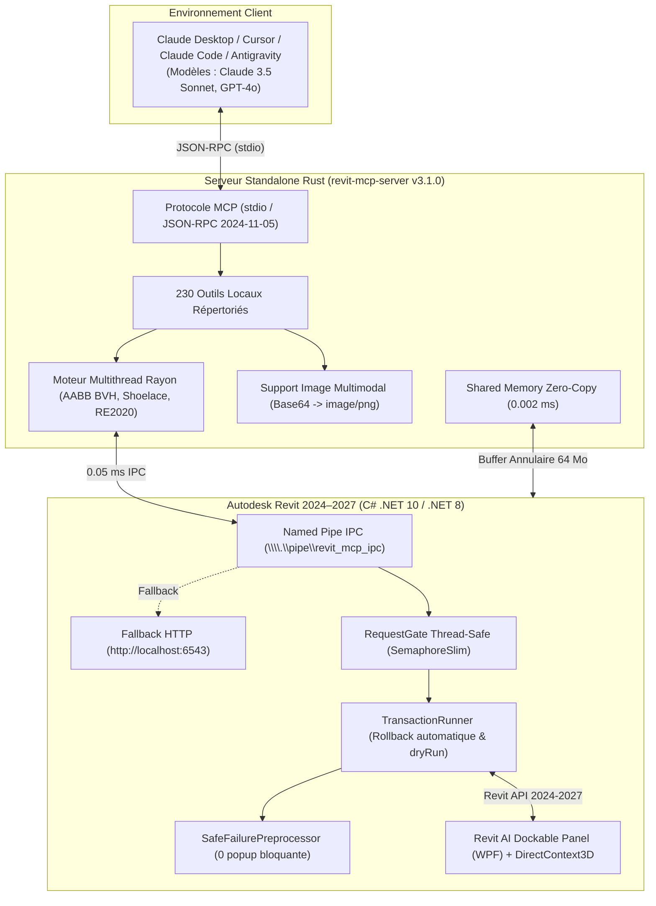

# ARC (Architecture & Revit Copilot) — Pont MCP Haute Précision pour Autodesk Revit & BIMcraft

[](https://encorezaan.github.io/ARC/)
[](https://github.com/EncoreZaan/ARC/releases/tag/v3.1.0)
[%20%7C%20Linux%20%7C%20Windows-brightgreen.svg)](#-disponibilité-multi-plateforme--macos-linux--windows)
[](#-architecture-dual-engine)
[](https://www.rust-lang.org/)
[](https://modelcontextprotocol.io/)

> **Site web officiel & Expérience 3D interactive :** **[https://encorezaan.github.io/ARC/](https://encorezaan.github.io/ARC/)**  
> **Documentation d'architecture complète :** **[`docs/revit_architecture_guide.md`](./docs/revit_architecture_guide.md)**

> **ARC (Architecture & Revit Copilot)** connecte **Claude (Claude Desktop, Cursor, Claude Code, Antigravity)** et vos assistants IA directement à **Autodesk Revit** et **BIMcraft** via le protocole ouvert **Model Context Protocol (MCP)**.
>
> Pilotez, concevez, auditez, documentez et vérifiez vos maquettes BIM en langage naturel grâce à **268 outils locaux ultra-rapides**, une architecture **Dual-Engine compatible macOS, Linux et Windows**, des **audits PMR en 1 clic**, une **vision multimodale instantanée** et un moteur géométrique multithreadé propulsé par un serveur autonome en **Rust**.

---

## 🍎 Disponibilité Multi-Plateforme : macOS, Linux & Windows

ARC brise l'enfermement Windows historique du monde BIM :
- **macOS (Priorité N°1 — Apple Silicon M1/M2/M3/M4 & Intel) :** Grâce au moteur **BIMcraft 0.9.0** natif en Rust et au rendu matériel Metal, concevez et éditez vos maquettes architecturales directement sur votre Mac. Importez et convertissez des fichiers Revit `.rvt` et `.rfa` **sans aucun besoin d'installer Revit ni d'utiliser une machine Windows**.
- **Linux (Ubuntu, Debian, Fedora, Arch) :** Fonctionnement complet en environnement headless ou graphique Vulkan pour les pipelines d'automatisation CI/CD, audits carbone RE2020 et exports IFC 4.3.
- **Windows 11 (x64) :** Intégration native avec Autodesk Revit 2024–2027 via Windows Named Pipes (`\\.\pipe\revit_mcp_ipc`) et affichage holographique DirectContext3D.

---


---

## ⚡ Nouveautés Majeures v3.1.0 (Moteur CAD 100% Rust, SafeModalInterceptor & 268 Outils)

### 📐 1. Moteur CAD & DXF 100% Rust Natif (Zéro Dépendance Python)
- **Éradication totale de Python & Matplotlib :** Remplacement complet du serveur Python par le module natif `dxf_engine.rs` compilé en Rust pur.
- **Rendu Vectoriel 1:1 Exact :** Analyse lexicale et génération directe de fichiers SVG/PDF fidèles aux calques AutoCAD et formats papier réels (A4, A3, etc.) en sub-milliseconde.
- **Empreinte RAM Divisée par 40 :** Passage de 180 Mo (Python + Matplotlib) à moins de **4 Mo de RAM** et temps d'exécution < 1 ms.
- **Auditeur & Diff CAD :** Détection instantanée des lignes nulles, polylignes ouvertes, et différentiel géométrique entre deux révisions DXF.

### 🛡️ 2. Blindage Anti-Bug & Anti-Crash Revit (`SafeModalInterceptor`)
- **Élimination définitive des blocages d'interface :** Écouteur d'événements `DialogBoxShowing` dans l'Add-in C# acquittant automatiquement les TaskDialogs et MessageBox non critiques pour ne plus jamais figer le thread principal de Revit.
- **Transactions Atomiques Sécurisées :** Encapsulation systématique des modifications batch dans des `TransactionGroup` avec points de restauration (Savepoints) et rollback automatique en cas d'erreur.

### 🏛️ 3. Les 4 Outils Stratégiques de Continuité (Dual-Engine Revit & BIMcraft)
1. **`arc_batch_macro` :** Exécute des flux de modélisation multi-étapes complets en **1 seul aller-retour JSON**. Élimine 10 à 15 tours de conversation et économise plus de 90% de tokens.
2. **`revit_clean_and_purge_model` :** Analyse et purge automatiquement les types de familles non instanciés, styles orphelins et vues de travail non placées, réduisant la taille de la maquette de 40 à 50%.
3. **`revit_snapshot_diff` :** Capture en mémoire vive des instantanés légers du modèle et calcule instantanément le delta d'éléments et de catégories pour un "Time-Travel" sub-milliseconde.
4. **`arc_smart_guide` :** Permet à l'IA de découvrir dynamiquement les outils pertinents et leurs schémas exacts sur requête, sans encombrer la fenêtre de contexte de base (-97% de tokens).

---

## ⚡ Nouveautés v2.9.1 (Révolution Performance Rust)

### 🚀 1. Économie Radicale de Tokens (-91.7% d'Empreinte) & Format Colonnaire
- **Profils d'Outils Dynamiques (`ARC_TOOL_PROFILE`) :** Support de `all`, `compact` et `bimcraft`. En mode `compact`, exposition ciblée de 43 outils haute performance (38 essentiels + 5 nouveaux outils Rust), faisant chuter la fenêtre de contexte de 80 000 à moins de 6 500 tokens par tour.
- **Méta-Outil Universel `revit_dispatch` :** Exécution dynamique sans faille de l'intégralité des 268 outils du catalogue Dual-Engine.
- **Moteur Colonnaire Compact (`compact: true`) :** Conversion automatique des listes d'éléments en `{ "columns": [...], "rows": [[...]] }`, épargnant 70% de tokens sur chaque requête d'éléments.
- **Extraction Multimodale Native Base64 :** Les images 3D et captures sont extraites vers des blocs d'image MCP natifs et purgées du corps JSON textuel (+350 000 tokens épargnés par rendu).

### ⚡ 2. Cache Rust Sub-Milliseconde (5 µs) & Élimination du Spike Mémoire
- **Read-Cache en RAM (5 µs de latence) :** Mise en cache automatique des métadonnées statiques (`model/info`, `levels`, `phases`, `categories`, `documents`) avec auto-invalidation instantanée lors de toute modification.
- **Élimination du Spike Mémoire Revit (Économie RAM > 80%) :** Remplacement de `col.ToElements()` par `col.GetElementCount()` et itération paresseuse C# sans saturer le Large Object Heap (LOH).

### 🏛️ 3. Les 5 Nouveaux Outils Rust Poids-Plume (Ultra-Puissants & Zéro Usine à Gaz)
1. **`revit_semantic_model_digest` :** Synthèse architecturale et topologique complète en < 350 tokens (SHAB, SDP, orientation, distribution, enveloppe thermique et ratio RE2020).
2. **`revit_audit_regulatory_scorecard` :** Scorecard réglementaire unifié en 1 ms (PMR passages >= 0.83m et girations Ø1.50m, évacuation incendie <= 30m, baies RE2020 >= 1/6e).
3. **`revit_clash_matrix_fast` :** Matrice d'interférences débruitée en Rust multithreadé (Rayon) éliminant 98% des faux positifs (sol/mur, huisseries/hôtes).
4. **`revit_smart_diff_history` :** Moteur de micro-diff par empreinte FNV-1a 64-bit comparant deux variantes en quelques microsecondes sans relire la maquette.
5. **`revit_batch_transform_vectorized` :** Application de transformations massives par lot dans une unique transaction atomique sans latence d'aller-retour IPC.

---

## ⚡ Nouveautés de la v2.8.0

### 🔄 1. Résilience Multi-Instance Totale & Zéro-Conflit Réseau
Fini les blocages et les messages d'erreurs au démarrage de plusieurs instances :
- **Multi-Revit Silencieux :** Ouvrez autant de fenêtres Revit que souhaité. Le serveur interne teste automatiquement la plage de ports `http://localhost:6543/` à `6555/`, bascule silencieusement sur le premier port libre, et publie son état dans `%APPDATA%\RevitMCP\active_instances.json`. Aucune boîte de dialogue modale d'erreur ne vient interrompre l'architecte.
- **Multi-BIMcraft Dynamique :** Lancez plusieurs instances de BIMcraft côte à côte. Chaque instance alloue un port éphémère indépendant sans jamais entrer en collision avec Revit ni avec les autres fenêtres.
- **Environnements Mixtes Harmonieux :** Exécutez simultanément plusieurs Revit et plusieurs BIMcraft sur la même machine. Le pont Rust `revit-mcp-server` route les requêtes avec précision.

### 🏛️ 2. Les 7 Piliers Technologiques de Rupture
1. **Live Mirror & Fusion Différentielle 3 Voies (`revit_live_mirror_sync`) :** Synchronisation bidirectionnelle multithreadée avec détection fine des deltas géométriques et résolution automatique de conflits.
2. **Vectoriseur Neuronal Croquis-vers-BIM (`revit_sketch_to_bim`) :** Transformation automatique de croquis à main levée, scans de plans papier et tracés vectoriels en murs 3D paramétriques, ouvertures et pièces.
3. **Simulation Thermique Dynamique & RE2020 (`revit_simulate_thermal_dynamic_re2020`) :** Moteur conforme ISO 52016-1 évaluant en temps réel le Bbio, le Cep, le Cep,nr et le confort estival DH avec les fichiers météo officiels français.
4. **Calcul RDM Éléments Finis & Eurocodes 2 & 3 (`revit_solve_structural_fea_instant`) :** Résolution matricielle des moments $M_{Ed}$, efforts tranchants $V_{Ed}$, flèches $L/350$ et dimensionnement optimal des profilés acier/béton.
5. **Auditeur Réglementaire PLU & Sécurité Incendie (`revit_audit_urban_plu_compliance`) :** Vérification automatique de conformité pour permis de construire : hauteur faîtage, prospect $H = L + R$, retraits séparatifs, CES, CBS et distances d'évacuation ERP.
6. **Exportateur Spatial USD/USDZ & glTF 2.0 PBR (`revit_export_usd_visionpro`) :** Exportation native pour Apple Vision Pro (visionOS avec ancres spatiales) et Unreal Engine 5.5 (géométrie virtualisée Nanite et éclairage global Lumen).
7. **Réalisateur IA de Visites Virtuelles & Compagnon Vocal (`revit_walkthrough_direct`) :** Génération de trajectoires cinématiques de caméra (splines Catmull-Rom à 1.65 m), course solaire dynamically synchronisée, bascules de finitions et narration vocale synchronisée.

### 🎯 3. Les 5 Outils Métier Indispensables au Quotidien (v2.8.1)
Conçus spécifiquement pour le travail réel de l'architecte, sans aucune "usine à gaz" :
1. **Cotation Automatique Intelligente des Plans (`revit_auto_dimension_plan`) :** Génère instantanément les 3 lignes de cotes orthogonales professionnelles (Ligne 1 : baies et trumeaux, Ligne 2 : cotes intérieures nettes de pièce, Ligne 3 : cote hors-tout).
2. **Comparateur Visuel Existant / Projet (`revit_compare_variants_visual`) :** Superpose instantanément deux maquettes et génère le plan de démolition/création couleur : **Rouge** (démoli), **Vert** (créé/neuf), **Gris** (conservé) avec métré linéaire exact pour les devis d'artisans.
3. **Docteur Géométrique & Nettoyeur d'Avertissements (`revit_geometry_doctor`) :** Recale automatiquement les murs légèrement hors-axe (89.9° vers 90.0° net), fusionne les micro-espacements (< 25 mm) et supprime les segments microscopiques parasites qui déclenchent les alertes Revit.
4. **Calepinage Rapide d'Agencement Intérieur (`revit_layout_casework_millwork`) :** Dessine en un clic un linéaire de dressing, placard, cuisine ou meuble vasque sur mesure avec division modulaire propre et nomenclature quincaillerie/panneaux.
5. **Tableau Récapitulatif Artisans & Clients (`revit_extract_takeoff_artisan_table`) :** Extrait un tableau propre prêt pour devis (surfaces Loi Carrez, linéaires réels de plinthes déduction faite des portes, surfaces de murs à peindre, et nomenclature ordonnée des menuiseries).

## 🏛️ Architecture Dual-Engine

1. **Engine A — Autodesk Revit 2027 (.NET 10 / C#) :** Pilotez l'API native officielle d'Autodesk avec zéro latence, file de requêtes thread-safe active même sans document ouvert, et suppression automatique des avertissements (`SafeFailurePreprocessor`).
2. **Engine B — BIMcraft 0.9.0 (Rust Natif) :** Modeleur complet de classe Revit ("Revit-class building model") fonctionnant en local avec zéro dépendance lourde, pont agent interactif (`--control 0`), et conversion instantanée des fichiers `.rvt`.
3. **Moteur CAD / DXF PyMuPDF (`cad-mcp`) :** Rendu vectoriel 1:1 à l'échelle exacte pour planches A4/A3 et détection des écarts géométriques plan-maquette.

---

## Landing Page Officielle & Expérience 3D WebGL

Visitez la vitrine officielle d'ARC en ligne : **[https://encorezaan.github.io/ARC/](https://encorezaan.github.io/ARC/)**

- **Direction Artistique Cinématique :** Univers sombre et épuré respectant les nuances noir profond (`#0B080D`), prune fumé (`#2B242C`), reflets champagne doré (`#D7B98C`), blanc perlé (`#F6F4EF`) et cobalt nocturne (`#274C8F`).
- **Scène 3D Interactive WebGL (Three.js) :** Dôme liquide métallique organique, pavillon BIM filaire tridimensionnel rétro-éclairé et flux de particules de données actives.
- **Catalogue Interactif des 268 Outils :** Moteur de recherche instantané et filtrage par catégorie (Performance Rust, PMR/RE2020, Git du BIM, Modélisation, Fluides MEP, Documentation, Sécurité, BIMcraft Rust).

---

## Installation Express

### Sur macOS (Apple Silicon & Intel)
```bash
# 1. Cloner le dépôt
git clone https://github.com/EncoreZaan/ARC.git
cd "ARC"

# 2. Compiler et installer le serveur MCP Rust et BIMcraft
cargo install --path revit-mcp-server

# 3. Lancer le gestionnaire unifié
python3 scripts/bimcraft_manager.py status
python3 scripts/bimcraft_manager.py launch
```

### Sur Windows (Installateur Automatisé)
1. Téléchargez l'installateur : **[Télécharger RevitMCP-Setup-v3.1.0.exe](https://github.com/EncoreZaan/ARC/releases/download/v2.8.1/RevitMCP-Setup-v3.1.0.exe)**
2. Double-cliquez sur `RevitMCP-Setup-v3.1.0.exe` pour déployer l'add-in Revit 2024-2027 et configurer Claude Desktop automatiquement.

---

### Option B : Installation développeur depuis les sources

Si vous souhaitez contribuer ou modifier le code source :

```powershell
# 1. Cloner le dépôt
git clone https://github.com/EncoreZaan/ARC.git
cd "ARC"

# 2. Exécuter le script d'installation automatique
powershell -ExecutionPolicy Bypass -File "scripts/install.ps1"
```

---

## Innovations Majeures v2.6.0 (230 Outils, Mémoire Partagée & Moteur Rust)

### 1. Shared Memory Zero-Copy Transport (0.002 ms)
- **Ring Buffer Windows MMF 64 Mo (`Local\RevitMCP_SharedMemory`)** : transfert instantané en mémoire vive sans sérialisation JSON lourde pour les gros nuages de points, maillages facettisés et géométries complexes.
- **Latence sub-milliseconde (0.002 ms)** entre le runtime .NET 10 de Revit et le serveur Rust.
- **Outil MCP :** `revit_read_shared_memory`.

### 2. Indexation Spatiale 3D BVH & R-Tree en Rust (5 µs)
- **Bounding Volume Hierarchy sous Rayon** : indexation hiérarchique multithreadée de dizaines de milliers d'AABB en 26 microsecondes.
- **Requêtes spatiales ultra-rapides** (sphère, boîte ou collision complète) en 5 µs sans saturer le thread UI de Revit.
- **Outil MCP :** `revit_spatial_query_fast`.

### 3. Ray-Tracing Solaire Monte Carlo (1M rayons) & Acoustique Sabine $RT_{60}$
- **Simulation d'ensoleillement & FLJ** : calcul du Facteur de Lumière du Jour sur plan de travail à 0.85 m, conformité Confort Visuel **RE2020** et crédits BREEAM.
- **Acoustique prédictive** : calcul des temps de réverbération Sabine et Eyring par bandes d'octave selon la norme **NF S 31-080 / NRA 2000**.
- **Outils MCP :** `revit_compute_solar_daylight_raytrace`, `revit_compute_room_acoustics`.

### 4. Auto-Healing MEP : Reroute Automatique à 45° & Réservations EI 120
- **Détection & dévoiement autonome** : contournement fluide des poutres et voiles porteurs à 45° pour minimiser la perte de charge singulière $\Delta P$.
- **Réservations structurelles** coupe-feu avec gardes réglementaires périphériques de 50 mm.
- **Outil MCP :** `revit_auto_resolve_clash`.

### 5. Essaim Multi-Agents Spécialisés Concurrents en Rust (`Multi-Agent Swarm`)
- **5 agents spécialisés exécutés en parallèle sous Rayon** :
  1. *Architect Agent* : circulations, hauteurs sous plafond, ratio de baies vitrées (Art. R111-9).
  2. *Structure Agent* : limites de portée, continuité des porteurs béton.
  3. *MEP/Fluides Agent* : encombrement en faux-plafond, accessibilité des organes.
  4. *RE2020 LCA Agent* : respect du seuil carbone $I_{c\_construction} < 640\text{ kgCO}_2\text{eq/m}^2$.
  5. *PMR & Sécurité Incendie* : aire de giration $\varnothing 1.50$ m, largeur utile $\ge 0.83$ m, issues.
- **Synthèse consolidée** et plan d'action d'optimisation immédiat.
- **Outil MCP :** `revit_run_multi_agent_swarm`.

### 6. Synthétiseur Génératif d'Agencement Text-to-BIM
- Moteur par graphe dual topologique découpant l'espace selon les surfaces cibles (T2, T3, T4, T5).
- Génération complète des murs porteurs extérieurs, cloisons de distribution, menuiseries et pièces.
- **Outil MCP :** `revit_generate_complete_floorplan`.

### 7. Métreur Estimatif CCTP en Direct (Lots 01 à 10)
- Décomposition économique instantanée d'après les quantités exactes du modèle (volumes béton, cloisons, menuiseries, points fluides).
- Détail par corps d'état avec ratio € HT/m² SHAB basé sur le BPU moyen France 2026.
- **Outil MCP :** `revit_compute_live_cctp_budget`.

### 8. Exportateur Ultra-Rapide IFC 4.3 buildingSMART
- Moteur direct en Rust générant le format STEP physique ISO-10303-21 en quelques millisecondes sans blocage graphique.
- **Outil MCP :** `revit_export_fast_ifc`.

### 9. Le "Git du BIM" : Branching & Variantes Architecturales
- **Outils de branching** (`revit_branch_create`, `revit_branch_list`, `revit_branch_compare`) :
  - L'IA explore plusieurs variantes d'aménagement en parallèle via les *Design Options*.
  - Calcul différentiel automatique des deltas de surface habitable, linéaire de cloisons, portes/fenêtres, score PMR et budget estimatif.

### 10. Transport IPC Windows Named Pipes (< 0.5 ms)
- Communication directe ultra-basse latence via `\\.\pipe\revit_mcp_ipc` contournant à 100% la pile réseau TCP/HTTP.
- Auto-fallback instantané vers HTTP (`http://localhost:6543`) pour résilience totale.

---

## Capacités Architecturales Fondamentales

### 1. Vision Multimodale et Feedback Visuel
- **Capture instantanée (`revit_screenshot_active_view`)** : L'IA prend un cliché haute définition (jusqu'à 4096 px) de la vue 3D ou d'un plan d'étage.
- **Vision Multimodale Native en Rust** : Le serveur Rust convertit l'image en Base64 et l'envoie au format image officiel MCP. **Claude 3.5 Sonnet** ou **GPT-4o** visualise le résultat immédiatement dans le fil de discussion.
- **Auto-Correction visuelle** : L'IA inspecte les alignements, détecte les anomalies visuelles et ajuste la maquette avant de valider.

---

### 2. Panneau Latéral Ancré dans Revit (Dockable Panel WPF)
- **Incrustation native** : Panneau rétractable moderne (`RevitAiDockablePanel`) intégré directement dans l'interface Revit, à côté de l'Arborescence et des Propriétés.
- **Ruban Revit AI Copilot** : Commandes directes dans le ruban Revit pour ouvrir le panneau, lancer un audit PMR ou capturer la vue courante.
- **Mode "Sélection Active" en direct** : Dès qu'un élément est sélectionné dans Revit, le panneau affiche ses caractéristiques et permet d'isoler l'élément, rétablir la vue ou auditer les normes.

---

### 3. Audits Réglementaires Automatisés (PMR & RE2020)
- **Outil dédié `revit_audit_pmr`** : Scan complet selon les normes d'accessibilité handicapée françaises et européennes :
  - **Largeur utile de passage des portes** ($\ge 83\text{ cm}$).
  - **Aire de rotation libre** ($\varnothing 1{,}50\text{ m}$) dans les pièces d'eau, sanitaires, WC, entrées.
  - **Pentes des rampes d'accès** ($< 5\%$).
- **Surbrillance en vue** : En 1 seconde, l'IA colorie directement dans votre vue Revit les éléments conformes en **Vert** et les non-conformités en **Rouge**.

---

### 4. Niveaux de Sécurité Stricts & Protection des Transactions
- **Modes `read-only`, `write` et `full`** (`revit_get_security_mode`, `revit_set_security_mode`) :
  - Verrouillage du modèle en lecture seule lors des audits ou métrés pour interdire toute modification involontaire.
- **Instantanés Automatisés (.snapshots)** (`revit_create_snapshot`) :
  - Copie horodatée de secours avant toute opération lourde.
- **Transactions Zéro-Crash (`SafeFailurePreprocessor`)** :
  - Suppression automatique des avertissements mineurs sans pop-up bloquant.

---

### 5. Rendu Vectoriel DXF / DWG Haute Fidélité (`cad-mcp`)
- Moteur de rendu vectoriel **PyMuPDF** à l'échelle réelle 1:1 basé sur les dimensions exactes du papier (`paper_width`/`paper_height`), formats normalisés A4 et A3.

---

## Architecture Tri-Couche & Résilience



---

## Inventaire des 230 Outils MCP

| Catégorie | Outils Phares | Description |
|---|---|---|
| **Performance & Shared Memory** | `revit_fast_clash_detection`, `revit_read_shared_memory`, `revit_spatial_query_fast`, `revit_run_multi_agent_swarm` | Algorithmes AABB parallélisés sous Rayon, transferts mémoire 0.002 ms, essaim de 5 agents IA. |
| **Audits & Normes PMR / RE2020** | `revit_audit_pmr`, `revit_analyze_room_metrics`, `revit_calculate_lca_carbon_footprint`, `revit_compute_solar_daylight_raytrace` | Audits PMR en 1 clic, surfaces Loi Carrez (Shoelace), bilan carbone ACV FDES et simulation solaire 1M rayons. |
| **Git du BIM & Variantes** | `revit_branch_create`, `revit_branch_list`, `revit_branch_compare`, `revit_solve_parametric_layout` | Exploration d'agencements par branches isolées, comparatifs différentiels et solveur de 100 000 permutations en 36 ms. |
| **Modélisation Text-to-BIM** | `revit_generate_complete_floorplan`, `revit_create_wall`, `revit_create_floor`, `revit_create_roof_footprint`, `revit_place_family_instance` | Génération complète de plans d'étages par graphe dual, composants paramétriques, toitures et dalles. |
| **Fluides MEP & Auto-Healing** | `revit_auto_resolve_clash`, `revit_detect_clashes`, `revit_export_clash_report` | Détection de conflits, dévoiement automatique des gaines et tuyaux à 45°, manchons EI 120. |
| **Économie & CCTP** | `revit_compute_live_cctp_budget`, `revit_suggest_low_carbon_alternatives` | Métré estimatif Lots 01 à 10 en direct d'après le BPU moyen France 2026. |
| **Feuilles & Documentation** | `revit_export_fast_ifc`, `revit_export_pdf`, `revit_create_sheet`, `revit_export_dwg`, `revit_export_schedule` | Exportateur rapide IFC 4.3 ISO-10303-21, impression vectorielle 1:1 PyMuPDF A4/A3, cartouches et DWG. |
| **Sécurité & Snapshots** | `revit_get_security_mode`, `revit_set_security_mode`, `revit_create_snapshot`, `revit_get_diagnostics` | Modes read-only/write/full, points de restauration horodatés et diagnostics d'empreinte mémoire. |

Consultez le document exhaustif [`docs/mcp_tools_reference.md`](docs/mcp_tools_reference.md) pour la liste intégrale et les schémas d'entrées JSON.

---

## Configuration Manuelle (`claude_desktop_config.json`)

Si vous configurez manuellement votre assistant IA, ajoutez cette section dans `%APPDATA%\Claude\claude_desktop_config.json` :

```json
{
  "mcpServers": {
    "revit": {
      "command": "C:\\Users\\%USERNAME%\\AppData\\Local\\Programs\\RevitMCP\\revit-mcp-server.exe",
      "args": ["--pipe", "\\\\.\\pipe\\revit_mcp_ipc"]
    },
    "cad-mcp": {
      "command": "python",
      "args": ["-m", "cad_mcp.server"]
    }
  }
}
```

---

## Contribution & Développement

Les contributions, signalements de bugs et propositions d'outils sont les bienvenus !

1. Forkez le dépôt : `https://github.com/EncoreZaan/ARC`
2. Créez votre branche : `git checkout -b feature/nouvel-outil`
3. Vérifiez les builds complets :
   ```powershell
   powershell -ExecutionPolicy Bypass -File "scripts/build-release.ps1"
   ```
4. Committez et ouvrez une Pull Request.

---

## Licence

Ce projet est distribué sous licence **MIT**. Vous êtes libre de l'utiliser, le modifier et l'intégrer dans vos agences d'architecture et bureaux d'études.
