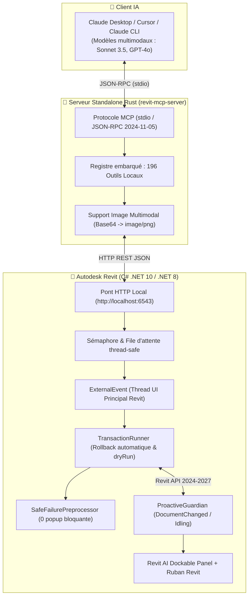

# ⚡ ARC (ARCHITECTURE & REVIT COPILOT) — LE PONT MCP INTELLIGENT POUR AUTODESK REVIT

[](https://github.com/EncoreZaan/ARC/releases/tag/v2.6.0)
[](https://www.autodesk.fr/products/revit/overview)
[](https://www.rust-lang.org/)
[](https://modelcontextprotocol.io/)
[](#-architecture--résilience-zéro-crash)

> **ARC (Architecture & Revit Copilot)** connecte **Claude (Claude Desktop, Cursor, Claude Code, Antigravity)** directement à **Autodesk Revit** via le protocole ouvert **Model Context Protocol (MCP)**.
>
> Pilotez, concevez, auditez, documentez et vérifiez vos maquettes BIM en langage naturel grâce à **230 outils locaux ultra-rapides**, un **panneau latéral WPF incrusté dans Revit**, des **audits PMR en 1 clic** et une **vision multimodale instantanée** propulsée par un serveur autonome en **Rust**.

---

## 🚀 Installation Express en 1 Clic (Zéro-Config)

Pas besoin de compiler du code ou de configurer des variables d'environnement. Tout est automatisé dans un installateur autonome ultra-léger de 4,8 Mo écrit en Rust.

### Option A : L'installateur universel (Recommandé) ⚡

1. Téléchargez la dernière version : **[📥 Télécharger RevitMCP-Setup-v2.6.0.exe](https://github.com/EncoreZaan/ARC/releases/download/v2.6.0/RevitMCP-Setup-v2.6.0.exe)**
2. Double-cliquez sur **`RevitMCP-Setup-v2.6.0.exe`**.
3. **C'est tout !** L'installateur :
   - Déploie automatiquement l'add-in Revit pour vos versions installées (2027, 2026, 2025 ou 2024).
   - Configure automatiquement le commutateur silencieux `DisableAddInSecurity=1` (zéro popup d'éditeur non vérifié au démarrage).
   - Configure le serveur MCP autonome Rust dans votre **Claude Desktop** (`claude_desktop_config.json`).
4. Démarrez **Revit**, ouvrez un projet, lancez **Claude Desktop** et discutez avec votre maquette !

---

### Option B : Installation développeur depuis les sources 🛠️

Si vous souhaitez contribuer ou modifier le code source :

```powershell
# 1. Cloner le dépôt
git clone https://github.com/EncoreZaan/ARC.git
cd "Revit-MCP"

# 2. Exécuter le script d'installation automatique
powershell -ExecutionPolicy Bypass -File "scripts/install.ps1"
```

---

## ⚡ Nouveautés Majeures v2.6.0 (Named Pipes Zero-Latence, Moteur Rust & Git du BIM)

### 🚀 Transport IPC Windows Named Pipes (< 0.5 ms)
- Communication directe ultra-basse latence via `\\.\pipe\revit_mcp_ipc` contournant intégralement la pile réseau TCP/HTTP.
- Auto-fallback instantané vers HTTP pour compatibilité universelle.

### 📐 Moteur Géométrique Multithreadé Déporté en Rust (Rayon)
- **Détection de clashs parallèle (`revit_fast_clash_detection`)** : calcul haute performance des collisions géométriques sur des milliers d'éléments en quelques millisecondes, libérant complètement le thread UI de Revit.
- **Métriques spatiales & Bioclimatiques (`revit_analyze_room_metrics`)** : calculs précis de surface (Green/Shoelace), compacité circulaire et ratio de vitrage bioclimatique RE2020.

### 🌿 Le "Git du BIM" : Branching & Variantes Architecturales
- **Outils d'exploration par branches** (`revit_branch_create`, `revit_branch_list`, `revit_branch_compare`) :
  - L'IA peut explorer plusieurs variantes d'aménagement en parallèle.
  - Calcul différentiel automatique des deltas de surface habitable, linéaire de cloisons, portes/fenêtres, score PMR et estimation du budget.

---

## ☁️ Nouveautés Majeures v2.3.0 (Enterprise Cloud & Sécurité)

### 🛡️ Niveaux de Sécurité Stricts & Garde-fous IA
- **Modes `read-only`, `write` et `full`** (`revit_get_security_mode`, `revit_set_security_mode`) :
  - Empêche toute corruption accidentelle par l'IA en verrouillant le modèle en lecture seule lors des phases d'audit ou de métré.
  - Le moteur de transactions `TransactionRunner` bloque proactivement toute tentative de modification si le mode de sécurité est actif.

### ☁️ Détection Cloud ACC / BIM 360 & Fichiers Centraux
- **Outils Cloud dédiés** (`revit_get_cloud_info`, `revit_sync_with_central`) :
  - Détection native des maquettes hébergées sur **Autodesk Construction Cloud (ACC)** ou **BIM 360** (Cloud Project GUID, Model GUID).
  - Gestion sécurisée de la synchronisation avec le fichier central (Synchronize with Central) et des sous-projets (Worksharing).

### 📸 Points de Restauration & Instantanés Automatisés (.snapshots)
- **Instantanés avec métadonnées** (`revit_create_snapshot`, `revit_list_snapshots`) :
  - Crée une copie de sauvegarde horodatée dans `_outils/.snapshots/` avec métadonnées JSON complètes avant d'exécuter des modifications structurelles lourdes.

### 🔍 Diagnostics Session & Empreinte Mémoire Revit
- **Outil de diagnostic en direct** (`revit_get_diagnostics`) :
  - Rapport complet sur la version/build exacte de Revit, l'empreinte mémoire vive (Working Set MB, Private Memory MB, Heap managé), le regroupement des avertissements (warnings) et l'intégrité des liens CAO/Revit.

### 📐 Rendu Vectoriel DXF / DWG Haute Fidélité (`cad-mcp`)
- Moteur de rendu vectoriel **PyMuPDF** à l'échelle réelle 1:1 basé sur les dimensions exactes du papier (`paper_width`/`paper_height`), fond blanc et traits noirs.

---

## 🌟 Les 5 Super-Pouvoirs Majeurs (v2.2.0)

### 👁️ 1. Le Feedback Visuel (L'IA qui a des yeux dans Revit)
Finies les modélisations à l'aveugle basées sur de simples coordonnées !
- **Capture instantanée (`revit_screenshot_active_view`)** : L'IA prend un cliché haute définition (jusqu'à 4096 px) de la vue 3D ou d'un plan d'étage.
- **Vision Multimodale Native en Rust** : Le serveur Rust convertit l'image en Base64 et l'envoie au format image officiel MCP. **Claude 3.5 Sonnet** ou **GPT-4o** visualise le résultat immédiatement dans le fil de discussion.
- **Auto-Correction visuelle** : L'IA inspecte les proportions d'une façade, identifie un mauvais alignement ou un clash visuel, et corrige la géométrie d'elle-même avant de valider.
- **Croquis & Esquisses scannés** : Vous pouvez lui soumettre une esquisse papier ou un schéma côté ; l'IA lit le dessin et le modélise directement dans Revit.

---

### 💬 2. Le Panneau Latéral Ancrable DANS Revit (Dockable Panel WPF)
Ne changez plus jamais de fenêtre entre Claude Desktop et Revit !
- **Incrustation native** : Un panneau rétractable moderne (`RevitAiDockablePanel`) intégré directement dans l'interface Revit, à côté de l'Arborescence du Projet et des Propriétés.
- **Nouvel onglet Ruban "Revit AI Copilot"** : Commandes directes dans le ruban Revit pour ouvrir le panneau, lancer un audit PMR ou capturer la vue courante.
- **Mode "Sélection Active" en direct** : Dès que vous cliquez sur un élément dans Revit (mur, porte, fenêtre, poteau), le panneau affiche son ID, sa catégorie, sa famille et ses dimensions, avec 4 boutons d'action instantanée :
  - 🔍 **Isoler l'élément**
  - 🔄 **Rétablir la vue**
  - 📋 **Audit d'accessibilité PMR**
  - 💬 **Demander conseil à l'IA**

---

### 📋 3. Les Audits Réglementaires Automatisés en 1 Clic (PMR & Normes)
Le cauchemar des architectes et bureaux d'études réglé en 1 seconde.
- **Outil dédié `revit_audit_pmr`** : Scan complet du projet selon les normes d'accessibilité handicapée françaises et européennes :
  - **Largeur utile de passage des portes** ($\ge 83\text{ cm}$ déduction d'huisserie faite).
  - **Aire de rotation libre** ($\varnothing 1{,}50\text{ m}$) dans les pièces d'eau, sanitaires, WC, entrées et dégagements.
  - **Pentes des rampes d'accès** ($< 5\%$).
- **Surbrillance automatique en vue** : En 1 seconde, l'IA colorie directement dans votre vue Revit les éléments conformes en **Vert** (`RGB: 46, 204, 113`) et les non-conformités en **Rouge** (`RGB: 231, 76, 60`).
- **Rapport synthétique et recommandations** : Calcul immédiat du taux de conformité globale (%) et propositions correctives ciblées (ex. *"Remplacer le bloc-porte 73 cm par un bloc-porte 90 cm"*).

---

### 🏗️ 4. Génération Spatiale & Macro-Conception (Architecte Génératif)
Oubliez la fastidieuse saisie mur par mur. Passez au **Macro-Prompting** architectural !
- **Outil dédié `revit_generate_spatial_layout`** :
  > *"Conçois-moi un pavillon T4 contemporain de 115 m² de plain-pied : séjour/cuisine traversant au Sud de 45 m², suite parentale isolée à l'Est, garage au Nord, toiture ardoise."*
- **Composition spatiale automatisée** :
  1. Résolution de l'organigramme fonctionnel et des surfaces Loi Carrez.
  2. Implantation de la dalle de sol (`Floor`) et de l'enveloppe thermique extérieure (`Wall`).
  3. Cloisonnement intérieur optimisé pour les circulations.
  4. Création des pièces (`Room`) avec étiquettes et calculs de surface réels.
  5. Insertion bioclimatique des menuiseries conforme **RE2020** (grandes baies vitrées au Sud avec ratio vitrage $\ge 1/6$) et portes conformes PMR.

---

### ⚡ 5. Copilote Proactif en Temps Réel (`ProactiveGuardian`)
L'IA ne dort jamais : elle veille en arrière-plan pendant que vous concevez !
- **Écoute continue des événements Revit** (`DocumentChanged` & `Idling`).
- **Détections intelligentes en direct** :
  - ⚠️ *"Attention, le déplacement du mur porteur a rendu la pièce 'Séjour' non délimitée."*
  - ⚠️ *"Vous venez de supprimer une pièce mais 3 séparateurs de pièces orphelins sont restés actifs."*
  - ⚠️ *"La fenêtre insérée possède un linteau plus haut que la sous-face de la dalle supérieure (risque de clash)."*
  - ⚠️ *"Détection d'un segment de mur anormalement court (< 15 cm) susceptible d'altérer les jonctions."*
- **Diffusion directe** : Notification instantanée dans le **Dockable Panel** et consultation via MCP (`revit_get_proactive_alerts`).

---

## 💬 Exemples de Prompts à tester dans Claude Desktop

Une fois Revit ouvert avec votre projet, collez ces exemples de requêtes dans Claude :

### 📸 Feedback Visuel
> *"Prends une capture d'écran de la vue 3D actuelle de Revit avec `revit_screenshot_active_view`, analyse l'harmonie des façades et indique-moi si des alignements de baies sont disgracieux."*

### 📋 Audit Réglementaire PMR
> *"Lance un audit PMR complet sur ma maquette avec `revit_audit_pmr`. Surligne en vert ce qui est conforme et en rouge les non-conformités directement dans la vue 3D, puis dresse-moi la liste des blocs-portes à remplacer."*

### 🏗️ Macro-Conception Immédiate
> *"Utilise `revit_generate_spatial_layout` pour implanter un pavillon T4 contemporain de 12,50 × 9,50 m avec dalle, cloisons, séjour traversant plein Sud, pièces nommées et baies vitrées conformes RE2020."*

### 🔍 Requête BIM & Sélection
> *"Quels sont les éléments actuellement sélectionnés dans Revit ? Donne-moi leurs cotes précises et vérifie s'ils respectent les hauteurs sous plafond avec `revit_get_height_at_point`."*

---

## 🛡️ Architecture & Résilience Zéro-Crash



### Principes de robustesse absolue :
1. **Thread-Safety Revit API** : Tous les appels transitent par un `ExternalEvent` marshalisé sur le thread UI principal de Revit. Aucun appel multi-thread illégal.
2. **Zéro Boîte de Dialogue Bloquante (`SafeFailurePreprocessor`)** : Les transactions absorbent automatiquement les avertissements mineurs (jonctions imparfaites, éléments déconnectés) sans jamais figer l'interface.
3. **Mode Simulation Universel (`dryRun: true`)** : Tous les outils d'écriture supportent `dryRun`. Testez n'importe quelle modification géométrique sans altérer la maquette.
4. **Rollback Automatique & Annulation** : En cas d'exception, `TransactionRunner` effectue un `RollBack()` immédiat. Historique complet disponible via `revit_undo` et `revit_redo`.
5. **Support Bilingue Universel (FR / EN / BuiltInCategory)** : Noms de catégories acceptés indifféremment en français (*Murs*, *Portes*, *Mobilier*), en anglais (*Walls*, *Doors*, *Furniture*) ou en énumération Revit (*OST_Walls*).
6. **Système Métrique Universel** : Conversions automatiques en millimètres (**mm**), degrés (**°**), mètres carrés (**m²**) et mètres cubes (**m³**).

---

## 📚 Inventaire des 196 Outils MCP

| Catégorie | Outils Phares | Description |
|---|---|---|
| **👁️ Vision & Feedback Visuel** | `revit_screenshot_active_view`, `revit_export_view_image`, `revit_render_view` | Capture instantanée multimodale Base64 pour l'analyse visuelle IA et rendus HD. |
| **📋 Audits & Réglementation** | `revit_audit_pmr`, `revit_detect_clashes`, `revit_check_clearance` | Audits PMR (portes, aires de giration, rampes), surbrillance couleur vert/rouge, détection de clashs. |
| **🏗️ Macro-Conception & Archi** | `revit_generate_spatial_layout`, `revit_create_wall`, `revit_create_floor`, `revit_create_roof_footprint` | Génération de pavillons complets, enveloppes thermiques, dalles, toitures, cloisons. |
| **⚡ Copilote Proactif** | `revit_get_proactive_alerts`, `revit_clear_proactive_alerts` | Interrogation des alertes de modélisation captées en tâche de fond (DocumentChanged). |
| **📐 Géométrie & Cotations** | `revit_get_wall_openings`, `revit_get_height_at_point`, `revit_auto_dimension_walls`, `revit_dimension_openings` | Raycast vertical 3D dédié, plans cotés automatiques, détection des ouvertures. |
| **🚪 Pièces, Cloisons & Finitions** | `revit_create_room`, `revit_tag_rooms`, `revit_get_rooms`, `revit_set_room_color_fill` | Création de pièces, étiquetage automatique, plans de repérage colorés. |
| **🎯 Sélection & Graphisme** | `revit_get_current_selection`, `revit_set_current_selection`, `revit_color_elements`, `revit_isolate_elements` | Interaction avec la sélection Revit en temps réel, surcharges graphiques temporaires. |
| **📄 Feuilles & Documentation** | `revit_create_sheet`, `revit_place_view_on_sheet`, `revit_auto_populate_sheets`, `revit_export_pdf` | Mises en page automatiques, alignement de cartouches, exports PDF et DWG. |
| **🔄 Modèle, Phases & Variantes** | `revit_list_open_documents`, `revit_activate_document`, `revit_get_design_options`, `revit_undo`, `revit_redo` | Gestion multi-documents, variantes de conception, historique de transactions. |

Consultez le document exhaustif [`docs/mcp_tools_reference.md`](docs/mcp_tools_reference.md) pour la liste intégrale et les schémas d'entrées JSON.

---

## ⚙️ Configuration Manuelle (`claude_desktop_config.json`)

Si vous utilisez Claude Desktop, l'installateur configure automatiquement ce fichier situé dans `%APPDATA%\Claude\claude_desktop_config.json` :

```json
{
  "mcpServers": {
    "revit": {
      "command": "C:/Users/<VOTRE_UTILISATEUR>/Documents/Devs/MCP Revit/revit-mcp-server/target/release/revit-mcp-server.exe",
      "args": [],
      "env": {
        "REVIT_HOST": "http://localhost:6543",
        "REVIT_TIMEOUT_MS": "120000"
      }
    }
  }
}
```

---

## 🤝 Contribution & Développement

Les contributions, signalements de bugs et propositions d'outils sont les bienvenus !

1. Forkez le dépôt : `https://github.com/EncoreZaan/ARC`
2. Créez votre branche : `git checkout -b feature/nouvel-outil`
3. Vérifiez les builds complets :
   ```powershell
   powershell -ExecutionPolicy Bypass -File "scripts/build-release.ps1"
   ```
4. Committez et ouvrez une Pull Request.

---

## 📄 Licence

Ce projet est sous licence **MIT**. Vous êtes libre de l'utiliser, le modifier et l'intégrer dans vos agences d'architecture et bureaux d'études.
