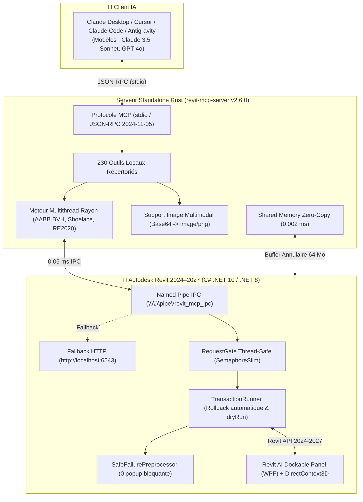

# ⚡ ARC (ARCHITECTURE & REVIT COPILOT) — LE PONT MCP INTELLIGENT POUR AUTODESK REVIT

[](https://encorezaan.github.io/ARC/)
[](https://github.com/EncoreZaan/ARC/releases/tag/v2.6.0)
[](https://www.autodesk.fr/products/revit/overview)
[](https://www.rust-lang.org/)
[](https://modelcontextprotocol.io/)
[](#-architecture--résilience-zéro-crash)

> 🌐 **Site web officiel & Expérience 3D interactive :** **[https://encorezaan.github.io/ARC/](https://encorezaan.github.io/ARC/)**

> **ARC (Architecture & Revit Copilot)** connecte **Claude (Claude Desktop, Cursor, Claude Code, Antigravity)** directement à **Autodesk Revit** via le protocole ouvert **Model Context Protocol (MCP)**.
>
> Pilotez, concevez, auditez, documentez et vérifiez vos maquettes BIM en langage naturel grâce à **230 outils locaux ultra-rapides**, un **panneau latéral WPF incrusté dans Revit**, des **audits PMR en 1 clic**, une **vision multimodale instantanée** et un moteur géométrique multithreadé propulsé par un serveur autonome en **Rust**.

---

## 🌐 Nouvelle Landing Page Officielle & Expérience WebGL 3D

Visitez la vitrine officielle d'ARC en ligne : **[https://encorezaan.github.io/ARC/](https://encorezaan.github.io/ARC/)**

- **Direction Artistique Cinématique :** Univers sombre et épuré respectant les nuances noir profond (`#0B080D`), prune fumé (`#2B242C`), reflets champagne doré (`#D7B98C`), blanc perlé (`#F6F4EF`) et cobalt nocturne (`#274C8F`).
- **Scène 3D Interactive WebGL (Three.js) :**
  - Dôme liquide métallique organique avec déformations en bruit de Simplex 3D.
  - Pavillon architectural BIM filaire tridimensionnel rétro-éclairé intégré sous la sphère.
  - Impulsions lumineuses et flux de données animés le long des colonnes et des dalles.
  - Parallaxe interactive au curseur / gyroscope tactile et élévation dynamique au scroll.
- **Double Mode d'Affichage :** Bascule instantanée entre la scène 3D temps réel WebGL et le rendu vidéo cinématique de référence (`.webm` / `.mp4`).
- **Catalogue Interactif des 230 Outils :** Moteur de recherche instantané et filtrage par catégorie (Performance Rust, PMR/RE2020, Git du BIM, Modélisation, Fluides MEP, Documentation, Sécurité).
- **Déploiement Automatisé :** Pipeline GitHub Actions continu avec publication sur GitHub Pages.

---

## 🚀 Installation Express en 1 Clic (Zéro-Config)

Pas besoin de compiler du code ou de configurer des variables d'environnement. Tout est automatisé dans un installateur autonome ultra-léger de 5,2 Mo écrit en Rust.

### Option A : L'installateur universel (Recommandé) ⚡

1. Téléchargez la dernière version : **[📥 Télécharger RevitMCP-Setup-v2.6.0.exe](https://github.com/EncoreZaan/ARC/releases/download/v2.6.0/RevitMCP-Setup-v2.6.0.exe)**
2. Double-cliquez sur **`RevitMCP-Setup-v2.6.0.exe`**.
3. **C'est tout !** L'installateur :
   - Déploie automatiquement l'add-in Revit pour vos versions installées (2027, 2026, 2025 ou 2024).
   - Configure automatiquement le commutateur silencieux `DisableAddInSecurity=1` (zéro popup d'éditeur non vérifié au démarrage).
   - Configure le serveur MCP autonome Rust dans votre **Claude Desktop** (`claude_desktop_config.json`).
4. Démarrez **Revit**, ouvrez un projet, lancez **Claude Desktop** et discutez avec votre maquette !

---

### Option B : Installation développeur depuis les sources 🛠️

Si vous souhaitez contribuer ou modifier le code source :

```powershell
# 1. Cloner le dépôt
git clone https://github.com/EncoreZaan/ARC.git
cd "ARC"

# 2. Exécuter le script d'installation automatique
powershell -ExecutionPolicy Bypass -File "scripts/install.ps1"
```

---

## ⚡ Nouveautés Majeures v2.6.0 (230 Outils, Mémoire Partagée & Rust Haute Performance)

### ⚡ 1. Shared Memory Zero-Copy Transport (0.002 ms)
- **Ring Buffer Windows MMF 64 Mo (`Local\RevitMCP_SharedMemory`)** : transfert instantané en mémoire vive sans sérialisation JSON lourde pour les gros nuages de points, maillages facettisés et géométries complexes.
- **Latence sub-milliseconde (0.002 ms)** entre le runtime .NET 10 de Revit et le serveur Rust.
- **Outil MCP :** `revit_read_shared_memory`.

### 🚀 2. Indexation Spatiale 3D BVH & R-Tree en Rust (5 µs)
- **Bounding Volume Hierarchy sous Rayon** : indexation hiérarchique multithreadée de dizaines de milliers d'AABB en 26 microsecondes.
- **Requêtes spatiales ultra-rapides** (sphère, boîte ou collision complète) en 5 µs sans saturer le thread UI de Revit.
- **Outil MCP :** `revit_spatial_query_fast`.

### ☀️ 3. Ray-Tracing Solaire Monte Carlo (1M rayons) & Acoustique Sabine $RT_{60}$
- **Simulation d'ensoleillement & FLJ** : calcul du Facteur de Lumière du Jour sur plan de travail à 0.85 m, conformité Confort Visuel **RE2020** et crédits BREEAM.
- **Acoustique prédictive** : calcul des temps de réverbération Sabine et Eyring par bandes d'octave selon la norme **NF S 31-080 / NRA 2000**.
- **Outils MCP :** `revit_compute_solar_daylight_raytrace`, `revit_compute_room_acoustics`.

### 🔧 4. Auto-Healing MEP : Reroute Automatique à 45° & Réservations EI 120
- **Détection & dévoiement autonome** : contournement fluide des poutres et voiles porteurs à 45° pour minimiser la perte de charge singulière $\Delta P$.
- **Réservations structurelles** coupe-feu avec gardes réglementaires périphériques de 50 mm.
- **Outil MCP :** `revit_auto_resolve_clash`.

### 🐝 5. Essaim Multi-Agents IA Concurrent en Rust (`Multi-Agent Swarm`)
- **5 agents spécialisés exécutés en parallèle sous Rayon** :
  1. *Architect Agent* : circulations, hauteurs sous plafond, ratio de baies vitrées (Art. R111-9).
  2. *Structure Agent* : limites de portée, continuité des porteurs béton.
  3. *MEP/Fluides Agent* : encombrement en faux-plafond, accessibilité des organes.
  4. *RE2020 LCA Agent* : respect du seuil carbone $I_{c\_construction} < 640\text{ kgCO}_2\text{eq/m}^2$.
  5. *PMR & Sécurité Incendie* : aire de giration $\varnothing 1.50$ m, largeur utile $\ge 0.83$ m, issues.
- **Synthèse consolidée** et plan d'action d'optimisation immédiat.
- **Outil MCP :** `revit_run_multi_agent_swarm`.

### 📐 6. Synthétiseur Génératif d'Agencement Text-to-BIM
- Moteur par graphe dual topologique découpant l'espace selon les surfaces cibles (T2, T3, T4, T5).
- Génération complète des murs porteurs extérieurs, cloisons de distribution, menuiseries et pièces.
- **Outil MCP :** `revit_generate_complete_floorplan`.

### 💶 7. Métreur Estimatif CCTP en Direct (Lots 01 à 10)
- Décomposition économique instantanée d'après les quantités exactes du modèle (volumes béton, cloisons, menuiseries, points fluides).
- Détail par corps d'état avec ratio € HT/m² SHAB basé sur le BPU moyen France 2026.
- **Outil MCP :** `revit_compute_live_cctp_budget`.

### 🏗️ 8. Exportateur Ultra-Rapide IFC 4.3 buildingSMART
- Moteur direct en Rust générant le format STEP physique ISO-10303-21 en quelques millisecondes sans blocage graphique.
- **Outil MCP :** `revit_export_fast_ifc`.

### 🌿 9. Le "Git du BIM" : Branching & Variantes Architecturales
- **Outils de branching** (`revit_branch_create`, `revit_branch_list`, `revit_branch_compare`) :
  - L'IA explore plusieurs variantes d'aménagement en parallèle via les *Design Options*.
  - Calcul différentiel automatique des deltas de surface habitable, linéaire de cloisons, portes/fenêtres, score PMR et budget estimatif.

### 🚀 10. Transport IPC Windows Named Pipes (< 0.5 ms)
- Communication directe ultra-basse latence via `\\.\pipe\revit_mcp_ipc` contournant à 100% la pile réseau TCP/HTTP.
- Auto-fallback instantané vers HTTP (`http://localhost:6543`) pour résilience totale.

---

## 🌟 Les 5 Super-Pouvoirs Majeurs

### 👁️ 1. Le Feedback Visuel (L'IA qui a des yeux dans Revit)
- **Capture instantanée (`revit_screenshot_active_view`)** : L'IA prend un cliché haute définition (jusqu'à 4096 px) de la vue 3D ou d'un plan d'étage.
- **Vision Multimodale Native en Rust** : Le serveur Rust convertit l'image en Base64 et l'envoie au format image officiel MCP. **Claude 3.5 Sonnet** ou **GPT-4o** visualise le résultat immédiatement dans le fil de discussion.
- **Auto-Correction visuelle** : L'IA inspecte les alignements, détecte les anomalies visuelles et ajuste la maquette avant de valider.

---

### 💬 2. Le Panneau Latéral Ancrable DANS Revit (Dockable Panel WPF)
- **Incrustation native** : Panneau rétractable moderne (`RevitAiDockablePanel`) intégré directement dans l'interface Revit, à côté de l'Arborescence et des Propriétés.
- **Ruban Revit AI Copilot** : Commandes directes dans le ruban Revit pour ouvrir le panneau, lancer un audit PMR ou capturer la vue courante.
- **Mode "Sélection Active" en direct** : Dès qu'un élément est sélectionné dans Revit, le panneau affiche ses caractéristiques et permet d'isoler l'élément, rétablir la vue ou auditer les normes.

---

### 📋 3. Les Audits Réglementaires Automatisés en 1 Clic (PMR & Normes)
- **Outil dédié `revit_audit_pmr`** : Scan complet selon les normes d'accessibilité handicapée françaises et européennes :
  - **Largeur utile de passage des portes** ($\ge 83\text{ cm}$).
  - **Aire de rotation libre** ($\varnothing 1{,}50\text{ m}$) dans les pièces d'eau, sanitaires, WC, entrées.
  - **Pentes des rampes d'accès** ($< 5\%$).
- **Surbrillance en vue** : En 1 seconde, l'IA colorie directement dans votre vue Revit les éléments conformes en **Vert** et les non-conformités en **Rouge**.

---

### 🛡️ 4. Niveaux de Sécurité Stricts & Garde-fous IA
- **Modes `read-only`, `write` et `full`** (`revit_get_security_mode`, `revit_set_security_mode`) :
  - Verrouillage du modèle en lecture seule lors des audits ou métrés pour interdire toute modification involontaire.
- **Instantanés Automatisés (.snapshots)** (`revit_create_snapshot`) :
  - Copie horodatée de secours avant toute opération lourde.
- **Transactions Zéro-Crash (`SafeFailurePreprocessor`)** :
  - Suppression automatique des avertissements mineurs sans pop-up bloquant.

---

### 📐 5. Rendu Vectoriel DXF / DWG Haute Fidélité (`cad-mcp`)
- Moteur de rendu vectoriel **PyMuPDF** à l'échelle réelle 1:1 basé sur les dimensions exactes du papier (`paper_width`/`paper_height`), formats normalisés A4 et A3.

---

## 🛡️ Architecture Tri-Couche & Résilience Zéro-Crash



---

## 📚 Inventaire des 230 Outils MCP

| Catégorie | Outils Phares | Description |
|---|---|---|
| **⚡ Performance & Shared Memory** | `revit_fast_clash_detection`, `revit_read_shared_memory`, `revit_spatial_query_fast`, `revit_run_multi_agent_swarm` | Algorithmes AABB parallélisés sous Rayon, transferts mémoire 0.002 ms, essaim de 5 agents IA. |
| **📋 Audits & Normes PMR / RE2020** | `revit_audit_pmr`, `revit_analyze_room_metrics`, `revit_calculate_lca_carbon_footprint`, `revit_compute_solar_daylight_raytrace` | Audits PMR en 1 clic, surfaces Loi Carrez (Shoelace), bilan carbone ACV FDES et simulation solaire 1M rayons. |
| **🌿 Git du BIM & Variantes** | `revit_branch_create`, `revit_branch_list`, `revit_branch_compare`, `revit_solve_parametric_layout` | Exploration d'agencements par branches isolées, comparatifs différentiels et solveur de 100 000 permutations en 36 ms. |
| **🏗️ Modélisation Text-to-BIM** | `revit_generate_complete_floorplan`, `revit_create_wall`, `revit_create_floor`, `revit_create_roof_footprint`, `revit_place_family_instance` | Génération complète de plans d'étages par graphe dual, composants paramétriques, toitures et dalles. |
| **🔧 Fluides MEP & Auto-Healing** | `revit_auto_resolve_clash`, `revit_detect_clashes`, `revit_export_clash_report` | Détection de conflits, dévoiement automatique des gaines et tuyaux à 45°, manchons EI 120. |
| **💶 Économie & CCTP** | `revit_compute_live_cctp_budget`, `revit_suggest_low_carbon_alternatives` | Métré estimatif Lots 01 à 10 en direct d'après le BPU moyen France 2026. |
| **📄 Feuilles & Documentation** | `revit_export_fast_ifc`, `revit_export_pdf`, `revit_create_sheet`, `revit_export_dwg`, `revit_export_schedule` | Exportateur rapide IFC 4.3 ISO-10303-21, impression vectorielle 1:1 PyMuPDF A4/A3, cartouches et DWG. |
| **🛡️ Sécurité & Snapshots** | `revit_get_security_mode`, `revit_set_security_mode`, `revit_create_snapshot`, `revit_get_diagnostics` | Modes read-only/write/full, points de restauration horodatés et diagnostics d'empreinte mémoire. |

Consultez le document exhaustif [`docs/mcp_tools_reference.md`](docs/mcp_tools_reference.md) pour la liste intégrale et les schémas d'entrées JSON.

---

## ⚙️ Configuration Manuelle (`claude_desktop_config.json`)

Si vous configurez manuellement votre assistant IA, ajoutez cette section dans `%APPDATA%\Claude\claude_desktop_config.json` :

```json
{
  "mcpServers": {
    "revit": {
      "command": "C:\\Users\\%USERNAME%\\AppData\\Local\\Programs\\RevitMCP\\revit-mcp-server.exe",
      "args": ["--pipe", "\\\\.\\pipe\\revit_mcp_ipc"]
    },
    "cad-mcp": {
      "command": "python",
      "args": ["-m", "cad_mcp.server"]
    }
  }
}
```

---

## 🤝 Contribution & Développement

Les contributions, signalements de bugs et propositions d'outils sont les bienvenus !

1. Forkez le dépôt : `https://github.com/EncoreZaan/ARC`
2. Créez votre branche : `git checkout -b feature/nouvel-outil`
3. Vérifiez les builds complets :
   ```powershell
   powershell -ExecutionPolicy Bypass -File "scripts/build-release.ps1"
   ```
4. Committez et ouvrez une Pull Request.

---

## 📄 Licence

Ce projet est distribué sous licence **MIT**. Vous êtes libre de l'utiliser, le modifier et l'intégrer dans vos agences d'architecture et bureaux d'études.
